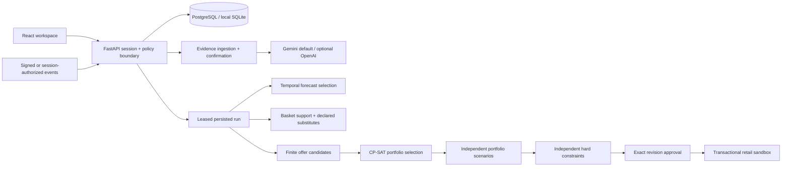

# Architecture and implementation decisions

The browser submits planning briefs and renders server-derived outcomes. A single FastAPI process serves both static React assets and the API. The server stores tenant-scoped operational snapshots, source documents, runs, revisions, receipts and events in a SQLAlchemy versioned entity table. SQLite is used locally; PostgreSQL is the deployment target. PostgreSQL behavior requires its own deployment verification before claiming it tested.

## Numerical authority

Prices, receipts, costs, liabilities and paid discounts use integer paise and Decimal half-up rounding at item boundaries. Contribution is net item receipts plus declared funding minus product/variable cost. The original seed has zero supplier funding and declares net-of-tax prices; it does not infer retailer tax treatment. Every bundle item independently passes the margin floor. Maximum liability is recomputed as the redemption cap times item discount plus media cost. Budget is a shared portfolio resource. No basket stacking is supported; a SKU coupon requires INR 500 minimum basket and one eligible unit/order.

Candidate screening caps the promoted opportunity shortlist at 20 products and retained offers at 2,000. Complement partners are eligible known-cost products. CP-SAT applies stock, budget, scope, offer overlap, SKU count and optional clearance-allocation limits. Surrogate demand cases and substitute pair penalties inform the objective. Any solver gap applies only to this finite set, not a globally optimal unrestricted retail strategy.

The independent simulator evaluates all 120 products in selected cities, including unpromoted substitutes. Baseline and promotion worlds share category/individual demand shocks, elasticity variation, coupon redemption and replenishment delays. FEFO stock and expiry constrain fulfilled demand. Writeoffs, media and discounts affect contribution. Its response curve differs from the optimizer surrogate. A negative simulated-mean proposal is repaired conservatively, or becomes no promotion; a hard clearance conflict escalates for review. Simulated clearance is an outcome distribution, not a guaranteed sell-through promise.

Forecast training uses 124 days; development and test each use 28 chronological days. Poisson and seasonal-naive candidates are selected using development WAPE. Test WAPE is held out from that choice. Price elasticity is a bounded observational estimate; it is not causal evidence. Co-purchase complements require support and lift. Substitute effects are explicit synthetic assumptions.

## Agent and recovery

The run stores seven checkpoints: read evidence, forecast demand, inspect relationships, generate offers, optimize, simulate and validate. Each advance acquires a lease with an increasing attempt token. A stale worker cannot commit under a newer token. Completed steps survive provider failures; retry retains the failure trace. A failed model call never activates a campaign. A worker resumes through UI/API advances; no unattended scheduler is configured by default.

Live mode interprets the natural-language brief within the monetary authorization boundary and uses actual provider function calls. It can choose forecast or relationship analysis first. Remaining mandatory tools are enforced by prerequisites and explicit allowed names. This is bounded agentic behavior, not unconstrained autonomous retail access. The live run has a six-call ceiling; extraction calls also count against deployment-wide dollar usage.

## Execution consistency

The tenant's retailer state row serializes financial and stock changes with row locking/CAS. Approval references the plan revision and snapshot. Execution revalidates the same revision, reserves stock FEFO and records a receipt in the same transaction. Only one sandbox plan is active per tenant. Duplicate execution keys and order IDs do not repeat debits. Media is charged at activation; redeemed discounts become spend. Pause releases future commitments and preserves fulfilled orders and incurred spend. New stock/budget evidence can pause unsafe commitments before replanning. Corrected evidence creates another immutable source version.

## Security and cost

HttpOnly signed sessions isolate public workspaces; mutations require CSRF. Paid use requires a server-configured owner token. API keys never enter the UI. A deployment-wide usage row reserves budget before calls, including new workspaces, and conservatively accounts for uncertain timeouts. Upload size, image dimensions, PDF pages, spreadsheet expansion, rows, model context and scenario counts are bounded. Content is untrusted evidence and cannot grant permissions. Policy application always requires confirmation. Enterprise webhook HMAC includes a timestamp and accepts only a five-minute window; event IDs provide idempotence.

There is no destructive reset/delete route. Startup only creates missing schema. Demo-workspace creation preserves existing workspaces. A public production deployment should additionally use platform rate/abuse limits and retention controls agreed with the owner; automatically deleting old records is deliberately absent.

## Handoff implementation notes

The earlier handoff described a folder-per-layer layout. This first runnable build groups each layer in a focused Python module (`forecast.py`, `planner.py`, `simulation.py`, `execution.py`, etc.) and keeps versioned routes in `main.py`. Financial and run boundaries remain server-side. The finished UI supersedes the earlier request for a minimal reference UI under the user's latest instruction. There are no remote-write outboxes because external publication is disabled; sandbox mutations are in one database transaction. Adding live vendor writes requires an outbox and read-back reconciliation before enabling them.

## Audit hardening

The final plan and completed checkpoint now commit in the same transaction. Failed persistence restores the current step rather than skipping past it. Model attempts are persisted before I/O, including unsuccessful calls; the six-attempt limit is not a success-only counter. Terminal-run races return the recorded state. The UI discovers saved runs after reload through the tenant-scoped run list.

Validation independently checks stock surviving each offer's start date and returns an exact batch reservation. Checkout uses the current server clock. Simulation freezes its evidence/date reference, bounds demand response by offer exposure, and pairs bundle redemptions within the same day. Zero-demand history retains a zero seasonal-naive forecast; fully censored history requires input.

Scope lists must be unique. Table headers and operational rows must be unambiguous; fractional integer amounts, future observations and empty inputs are rejected. Evidence confirmation requires explicit INR. Policy updates after pausing retain spent money and cannot set the budget below it. Event IDs and planning keys reject changed payloads. An interrupted event can finish its missing replan link on retry without repeating stock or budget changes.

Automatic authority compares actual offer terms, including quantities and prices, and is rechecked in the execution transaction. Owner-token rotation invalidates existing paid sessions. Workspace creation has a persisted hourly client-address limit; compute is limited to two simultaneous planning steps per process. Requests are bounded even without Content-Length. PostgreSQL startup uses an advisory transaction lock; only the SQLite startup race has been tested locally.

## API request allowance

The normal API quota is now 400 requests in a rolling 3600-second window per workspace, replacing the original process-local 180/minute counter. `ApiRateLimiter` persists accepted request timestamps in `_system/api_rate` rows and serializes consumption through `Store.mutate` (SQLite write reservation / PostgreSQL row lock). Concurrent workers and restarts share the quota through the database. Rejected calls do not append timestamps. No records or user data are deleted; expired quota timestamps are pruned within the counter record.

Middleware meters `/api/` reads/writes, including session refreshes and failed attempts, before body processing. Without a valid signed session, the bucket uses the direct client address and ignores raw forwarded headers. Webhook calls first use the client bucket, then consume the destination workspace bucket only after HMAC verification. Successful and throttled responses expose quota headers; HTTP 429 includes retry seconds. HTML, assets, health and API docs are outside the API quota. The separate workspace-creation limit (`WORKSPACE_CREATE_LIMIT_PER_HOUR`, default 500 per client address per hour) and model budget still apply. `API_RATE_LIMIT_PER_HOUR` defaults to 400 and rejects nonpositive configuration. PostgreSQL and hosted proxy behavior still require deployment validation.
# October 4 repair addendum

The live orchestrator has two bounded model decision boundaries: interpretation
of the permitted brief, then choice of forecasting or relationship analysis
first. Both numerical analyses remain mandatory. Successful decisions are
cached; the existing six-attempt ceiling covers transient recovery. Mandatory
numerical and validation steps dispatch deterministically. Offline evaluation
uses no model calls. Manual simulations and run advancement share the same
two-slot compute gate; async imports/evidence use a separate two-slot worker
gate. See `astra-verification.md` for current evidence and limitations.
