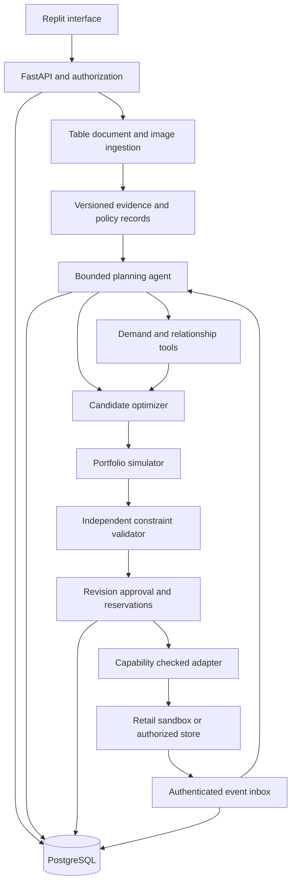

# Autonomous Promotion Planner Product Requirements Document

Version 1.0 | Prepared 1 October 2026 | Delivery deadline 11 October 2026 at 11:59 PM IST

This document specifies an Indian grocery e-commerce promotion planner for Problem 3 of the ET AI Hackathon Agentic Edition presented by Accenture. It is written for the participant, Codex implementing the core application, and Replit implementing and finishing the user interface. The submission target is all nine listed features at F3/D3, with reproducible evidence for every claim.

This is a product and implementation specification. No application, benchmark result, live integration, competition score or business uplift has yet been produced. Numerical acceptance thresholds below are our proposed engineering gates, not organizer thresholds. Winning is the objective; judge scores and competitive outcomes cannot be guaranteed.

## 1 Product decision

Working product name: **PromoPilot**. The descriptive submission title should be **Autonomous Promotion Planner for Indian Grocery Commerce**. Name availability has not been checked; the descriptive title remains usable.

Build a decision and execution layer that a retailer can connect to its existing commerce, inventory and customer systems. The primary user is a category or growth manager who needs a profitable, feasible promotion plan across cities. Grocery is the chosen vertical because perishable inventory, substitutes, complementary products, local demand and thin margins make every required feature commercially relevant.

Use a fictional Indian retailer with 120 SKUs, six categories, three fulfillment locations in Bengaluru, Mumbai and Delhi, four behavioral customer segments, 180 historical days and a seven-day planning window. These are proposed demo dimensions, not facts about Flipkart. The architecture will support longer horizons and larger catalogs; only tested scale may be claimed.

The product accepts operational data, policy documents and competitor promotion images. It extracts facts with source references, asks for missing critical values, generates candidate offers, evaluates interactions, solves a constrained selection problem, simulates outcomes, and publishes approved plans to a retail sandbox. It monitors supplied events and adjusts the plan within an explicit authorization envelope.

The distinguishing experience is a **decision record for every promotion**: evidence, assumptions, calculations, alternatives, constraint results, uncertainty and the reason a plan changed. This is our proposed differentiation, not a claim that the concept is unique in the market.

### Scope boundaries

All nine problem features are required for the submission. We will limit the number of SKUs, cities, supported offer types and external connectors to keep their implementation reliable. No required feature is relegated to a future roadmap.

The submission will not claim a replacement for an ERP, a universal CRM connector, a production Flipkart integration, a retail-trained foundation model, proven causal sales uplift or unattended nationwide operation. Those claims require access, data and validation that we do not currently have.

## 2 Competition requirements and delivery constraints

The supplied problem PDF is the authority for the feature grid and eight evaluation dimensions. Problem 3 is on pages 8–10; shared evaluation and submission requirements are on pages 2–4. Its F1/F2/F3 thresholds are two/five/seven features. D3 requires heterogeneous multimodal input and demonstrably high reliability. Teams must justify their position, and inaccurate coverage declarations can be penalized. There are no numerical criterion weights in that PDF.

The exact [Unstop event page](https://unstop.com/hackathons/crp-et-ai-hackathon-agentic-edition-presented-by-accenture-economic-times-1744885) specifies a Phase 2 deadline of 11 October 2026, 11:59 PM IST. Plan to submit on 10 October and retain 11 October for recovery. The page requires a working prototype repository, a PDF/PPT presentation and a two-to-four-minute demonstration video; it also requires public GitHub and accessible demo links. It describes eligibility including three or more years of professional experience and teams of one to four people. The participant remains the registered entrant; Codex is an implementation tool.

The [organizer microsite](https://economictimes.indiatimes.com/et-spotlight/accenture-ai-hackathon) requires original work developed during the event and allows open-source tools, libraries, datasets and models. Keep attribution and a record of dependencies and AI assistance. The reviewed public wording does not explicitly settle proprietary API use or AI coding-assistant use; check the authenticated submission instructions or organizer clarification before final submission. This uncertainty does not prevent a provider-neutral design or original implementation.

Confirmed user constraints: Phase 2 qualification and submission access are available; one human participant, Codex doing the core coding, Replit finishing the UI, an existing approximately USD 20 Replit subscription, Indian market, no existing retailer system and no private dataset supplied. Additional API or hosting spend has not been authorized. Use replaceable model providers and configurable spending limits; do not treat a subscription as unlimited API or compute credit.

## 3 Success criteria and judging evidence

Success means a judge can reproduce the advertised workflow, inspect why a decision was made, observe a meaningful change after new evidence, and verify that forbidden actions are blocked. A feature earns coverage only when its computation or behavior is demonstrated.

### All nine required features

| Requirement | Required behavior | Acceptance evidence |
| --- | --- | --- |
| R1 Select products | Rank eligible products by incremental contribution, stock age, clearance urgency and uncertainty; allow no promotion | Fixture includes an eligible winner, a low-margin exclusion and a product correctly left unpromoted; explain all three |
| R2 Choose mechanism | Compare percentage markdown, fixed-amount coupon and a two-product bundle; each has eligibility, redemption and cost semantics | Show the same objective producing different feasible mechanisms; unsupported channel mechanisms are blocked |
| R3 Optimize discount and strategy | Select discount, start date, duration, segment and channel from explicit candidate sets | Enumerated small cases match an independent optimum; show why a deeper discount can reduce profit |
| R4 Account for cannibalization | Estimate or assume substitution between related SKUs, expose evidence status, and include portfolio losses in simulation | In a planted substitute pair, individual SKU uplift rises while portfolio contribution falls; planner rejects that option |
| R5 Account for product relationships | Identify complements and substitutes separately; use basket support and lift for complement candidates with minimum-support filters | A supported complement becomes a bundle candidate; a weak association is flagged and excluded from confident recommendations |
| R6 Respect inventory | Use sellable stock, reserved quantities, replenishment, safety stock, batch expiry and fulfillment location | Bundle consumption is deducted from both items; stock exhaustion and expiry prevent further eligible sales |
| R7 Customize by geography | Produce location-specific plans from inventory, demand, holiday calendars, competitor observations and fulfillment boundaries | Same SKU receives different offers or no offer in two cities for evidence-backed reasons |
| R8 Use competitor intelligence | Extract competitor SKU, pack size, price, date, location and conditions; match products before comparing unit prices | Fresh comparable offer affects a plan; stale, ambiguous and mismatched-pack observations are excluded or require review |
| R9 Simulate before launch | Compare no promotion, a simple rule-based baseline and optimized plans under common uncertainty scenarios | Show portfolio contribution, revenue, clearance, stockouts and downside quantiles; infeasible plans cannot launch |

Duration and audience are mandatory outputs even though they are not separate entries in the nine-feature list. All plans also specify affected products, mechanism, discount, channel, geography, budget, validity period and policy version.

### Eight evaluation dimensions

| Published dimension | Product response | What the submission must show |
| --- | --- | --- |
| Significance and relevance | Improve promotion decisions under margins, inventory and commercial constraints | A category manager task and its measurable baseline |
| Innovation and originality | Evidence-linked decisions, robust portfolio selection and automatic repair after shocks | One continuous scenario in which these capabilities interact |
| Effective use of AI | Multimodal extraction, policy interpretation, ambiguous evidence handling and tool-directed planning | Live model calls affecting decisions, with provenance and validation |
| Technical complexity and execution | Typed data, candidate optimization, cross-product effects, simulation and transactional activation | Architecture, meaningful automated tests and a reproducible run |
| Agentic capability | Select tools, resolve data gaps, replan on events, recover from tool failure and operate inside permissions | Event-to-action trace, recovery demonstration and human escalation |
| Business impact | Compare contribution, waste, budget efficiency and planning effort against explicit baselines | Measured application timings and labelled simulated commercial outcomes |
| Prototype quality and usability | A coherent workflow with progressive detail and clear error recovery | Accessible working app, resettable demo and a concise video |
| Scalability, responsible AI and robustness | Tenant boundaries, confidence handling, bounded autonomy, audit history and recovery | Adversarial inputs, policy rejection, duplicate-event handling and measured load results |

### Evidence status

Every visible number and recommendation uses one of four labels: **observed** for a source value, **derived** for a reproducible calculation, **assumed** for a configured or estimated input without sufficient evidence, and **simulated** for a projected outcome. Actual customer experiment results, if ever collected, are separately labelled measured outcomes.

The evidence ledger maps each requirement to its test, demo step, architecture component, result file and limitations. Mark entries planned, implemented, tested or demonstrated. F3/D3 remains a target until the ledger establishes it; the declaration submitted to judges must match the actual result.

## 4 Users and principal workflows

The category manager creates plans and reviews commercial trade-offs. The finance approver changes or approves policy and spending authority. The operator connects data and inspects failures. A judge gets a restricted demo session with synthetic data and a reset function.

### Plan creation

1. Select retailer, cities, dates and objective. Default objective is incremental contribution after variable costs; clearance is a separately displayed goal or constraint.
2. Import inventory and transactions, upload a policy PDF and competitor flyer image, and inspect the evidence inbox.
3. Resolve blocking issues such as missing unit cost, conflicting policy or uncertain product match. Noncritical uncertainty may proceed with explicit assumptions and sensitivity analysis.
4. Request a plan. The agent retrieves evidence, calls demand and relationship tools, generates candidates, requests optimization and simulation, and checks the outcome.
5. Compare baseline and recommended plans. Open any recommendation to inspect source links, assumptions, portfolio effects and financial calculations.
6. Approve a specific plan revision. The backend revalidates current data, reserves budget and promotional stock, then activates it in the sandbox.

### Adaptation after change

Inject an authorized inventory update, new competitor offer or budget reduction. The system invalidates dependent plan results, creates a new revision and recomputes affected candidates and portfolio metrics. A safe change inside the preapproved envelope can activate in the sandbox. Changes outside it wait for approval. The previous plan and the reason for every difference remain visible.

### Impossible request

When a high clearance target conflicts with margin, budget or stock rules, return an infeasibility report with the conflicting inputs and suggested changes. Do not quietly reduce the margin floor or invent stock. Suggested policy changes require authorized acceptance and another simulation.

## 5 Interface requirements for Replit

Use a responsive desktop-first workspace. English is the default language; display INR, Indian digit grouping and IST. Calendar inputs must show the time zone. Avoid decorative agent avatars and artificial progress messages. Progress is driven by backend events.

| Screen | Required content and actions |
| --- | --- |
| Overview | Active plans, budget remaining, inventory at risk, contribution projection with uncertainty and evidence labels |
| Evidence inbox | Uploads, extracted fields, page/image references, timestamp, confidence basis, conflicts and accept/correct actions |
| Planning brief | Goal, date range, locations, segments, promotion types and policy constraints; natural-language input alongside editable fields |
| Plan comparison | No-promo baseline, rule baseline and optimized plan; portfolio totals and SKU details; uncertainty and trade-offs |
| Simulation | Scenario controls, common random seed, contribution distribution, stock movement, clearance, spend and sensitivity |
| Decision record | Source evidence, tool calls, calculations, concise rationale, rejected alternatives and constraint results |
| Approval and activity | Plan revisions, approvals, activation status, event feed, rollback or pause and material-change comparison |
| Integrations and evaluation | Connector capability/status, mapping errors, sync health and the requirement evidence ledger |

Every screen needs loading, empty, partial-data, validation-error, provider-unavailable and success states. Controls must work with keyboard input; charts have text summaries and do not rely on color alone. Critical approve/publish buttons show the precise revision and monetary envelope being authorized. Failed or stale results must never appear as an active successful plan.

## 6 Data and provenance requirements

The retailer is the tenant boundary. Every operational record includes `tenant_id`, stable internal ID, source system, source record ID, event time, ingestion time and version. Money uses integer paise; percentage calculations use fixed precision. Store timestamps in UTC and present them in IST. Unit conversion is explicit for pieces, grams, kilograms, milliliters and liters.

| Entity | Minimum fields |
| --- | --- |
| Product | SKU, title, brand, category, pack quantity/unit, MRP or declared list ceiling, tax treatment, unit cost and source |
| Inventory batch | SKU, location, physical stock, quantity basis, disjoint unavailable quantities, reservations, safety stock, expiry, expected replenishment and update version |
| Sales line | Basket/order ID, pseudonymous segment, SKU, quantity, location, time, paid price, promotion ID, return/cancellation status |
| Competitor observation | Comparable product, raw description, pack size, offer terms, effective price, location, observed/expiry time and source image/document |
| Customer segment | Behavioral definition, aggregate size, eligibility, consent/channel constraints where applicable; no sensitive attributes |
| Calendar event | Date range, applicable geography, event type and source; synthetic events visibly marked |
| Policy | Version, owner, effective dates, margin scope/floor, discount bounds, budgets, permitted mechanisms, exclusions and approval envelope |
| Relationship | SKU pair, complement/substitute type, estimated effect, support/sample count, method, interval and evidence status |
| Plan and offer | Immutable revision, data snapshot, objective, selected candidates, proposed timings/audience, forecasts, simulation and checks |
| Run and tool event | State, correlation ID, idempotency key, tool inputs/outputs, retries, model/prompt versions, token cost and summarized decision |

Uploaded policy and competitor content are untrusted evidence. Instructions embedded in them cannot change system permissions or invoke tools. The application applies file-size/type limits, parses uploads in isolation, and never executes macros or document code.

### Multimodal acceptance

Required formats are CSV/XLSX operational tables, text and scanned PDF policy pages, and PNG/JPEG competitor flyers or screenshots. The extraction workflow must reconcile information across formats and produce correct planning decisions. Text-plus-image evidence is the required multimodal scope; audio/video are optional only after release gates pass.

Each extracted field includes source ID, page or image region where available, raw value, normalized value, extraction method and validation outcome. Confidence combines matching quality and validation results calibrated on held-out fixtures; a model's self-reported confidence is insufficient. Missing cost, ambiguous currency, unclear discount terms or a conflicting margin floor block the affected recommendation. A human correction creates a new source version and rerun.

Proposed initial freshness rules are 15 minutes for launch-time inventory and 24 hours for competitor offers unless an explicit expiry is earlier. These are retailer-configurable demo policies, not universal standards. Missing or future timestamps are rejected; stale stock blocks activation until refreshed.

## 7 Promotion economics and constraints

The calculation engine, not the language model, computes money, available stock, budget and optimization feasibility. All calculations reference one immutable data snapshot and policy version.

### Accounting definition

For each fulfilled offer unit or basket, net receipts are the customer amount after retailer discounts, excluding pass-through tax, plus verified supplier funding. Contribution is net receipts less landed cost and applicable variable fulfillment, payment, channel and expected return costs. A manufacturer-funded discount is credited only with an explicit funding record. Unknown cost fields block confident financial claims.

Portfolio contribution is total contribution across promoted and affected unpromoted SKUs, less campaign media and fixed activation cost. Incremental contribution is promotion-world contribution minus no-promotion-world contribution under identical scenario conditions. Do not subtract discounts again after they already reduce receipts. Inventory write-off cost is recorded consistently in both worlds, rather than counting clearance value and avoided waste twice.

The default demo margin policy is a configurable minimum contribution-margin rate of 15% per offer, after variable costs. This is an illustrative policy, not a value in the competition brief. Support item-level, bundle-level or portfolio-level policy scope explicitly. Allocate bundle receipts by declared reference-price weights when item-level checks are required. A profitable bundle cannot bypass item floors unless the policy explicitly permits bundle-level assessment.

For a declared margin scope, let `R` be customer receipts excluding pass-through tax plus verified supplier funding and `V` be applicable landed and variable costs. Contribution-margin rate is `(R - V) / R`; reject nonpositive `R`. Fixed campaign cost is accounted at portfolio level. The report must show each term and distinguish known costs from estimated return allowances. This definition makes the denominator and funding treatment consistent across all services.

Marketing spend and discount subsidy have separate ledgers. A combined promotion envelope can cap both, but profit and budget accounting remain distinct. Reserve the maximum retailer-funded liability supported by redemption caps, including existing active offers. Expected spend alone cannot authorize an uncapped coupon campaign.

The initial fixed-amount coupon applies to one eligible SKU unit, once per order, after an explicitly stated pretax minimum basket value. It cannot stack with another coupon, markdown or bundle on that unit. Eligibility and redemption caps are checked at checkout. Bundle offers apply once per qualified pair with an explicit quantity cap and consume both components. Segments are mutually exclusive in the seeded demo; production overlapping memberships require an explicit eligibility priority. Basket-wide coupons are excluded from this release so subsidy and item-margin allocation remain unambiguous.

### Hard constraints

Reject offers that violate the selected margin scope, price bounds, allowed mechanisms, channel capabilities, geography, date validity, segment eligibility or parent-company exclusions. Candidate stock allocations cannot exceed sellable stock after reservations and safety stock. A bundle consumes every component. Inventory counters and budget reservations are updated transactionally and checked again at sandbox redemption.

For physical-stock sources, compute `sellable = max(0, physical_on_hand - unavailable - reserved - safety_stock)`, with expired and damaged units represented by disjoint unavailable buckets. Sources already reporting available-to-promise quantities declare that basis and map without subtracting the same reservations twice. Replenishment becomes usable only after confirmed receipt, or on its scenario arrival date in simulation. Cancelled orders release reservations; accepted returns re-enter stock only when their batch is inspected as sellable.

Clearance has explicit semantics: target quantity, location, deadline and whether it is a hard scenario constraint or a soft objective. Uncertain demand cannot guarantee physical clearance. Report the modeled probability of meeting a target and identify the scenarios in which it fails. Never equate a feasible plan with guaranteed future sales.

In the demo, clearance means fulfilled units sold from explicitly designated at-risk batches before their deadline. Allocate stock by first-expiry-first-out, net out qualifying cancellations/returns, and report the denominator as starting sellable units in those batches. Disposal is a separate event, never a successful sale; write-off occurs at the configured expiry/disposal time. This prevents ordinary sales from being credited to the wrong clearance batch.

### Candidate optimization

Initial candidate menus: no promotion; 5%, 10%, 15% or 20% markdown; fixed-value coupon at policy-approved values with minimum basket/redemption limits; and selected two-product bundles. Include start-date and three/five/seven-day duration choices, four segments and city eligibility. Candidate pruning must preserve a no-promotion option and log the reasons for removals.

Use a CPU-based integer optimizer over finite candidates. For the demo, permit at most one active mechanism per SKU/location/day and enforce shared stock and budget across overlapping segments. Bundle conflicts require explicit component constraints. The candidate model includes pairwise substitute/complement effects for a sparse, bounded set of supported pairs; linearize candidate-pair interactions or perform documented bounded search where needed. Do not advertise a globally optimal result over continuous prices or an unconstrained real market.

Bound each run to 20 shortlisted promoted SKUs, at most 2,000 offer candidates, 50 supported relationship edges and 5,000 candidate-interaction variables. These are initial profiling limits, not measured capacity. Keep the full 120-SKU portfolio in the impact simulation, including excluded substitutes. Log screening scores, excluded choices and the retained candidate set. Optimality refers only to that retained set; catalog screening remains a documented heuristic.

The objective is expected incremental contribution minus a configurable downside-risk penalty, with separate clearance targets. Show at least three feasible alternatives when available: profit focus, clearance focus and conservative risk. Report solver status, time limit, objective, feasible incumbent and optimality gap when the solver provides one. A timeout may return a verified feasible incumbent labelled accordingly; no valid incumbent produces a safe failure.

For scenarios `s` with weights `w_s` summing to one, use `sum(w_s * delta_contribution_s) - lambda * sum(w_s * max(0, -delta_contribution_s))`. Both terms have currency units; `lambda` is dimensionless, initially 0.5 as a demo assumption. The comparison baseline is no promotion in the same scenario. Changing risk preference changes the recorded policy/run settings. For the integer solver, scale scenario-weighted coefficients with an explicit rounding rule and validate totals using full-precision calculations.

An independent validator recalculates selected-offer economics, constraints and totals without trusting the optimizer's status or model explanation. Use brute-force enumeration as an oracle on small test cases. If the larger portfolio simulator exposes an unacceptable interaction or risk, add a exclusion/constraint and retry at most twice before returning a clear unresolved result.

Implementation should follow the integer-variable and status semantics documented in the [OR-Tools CP-SAT guide](https://developers.google.com/optimization/cp/cp_solver). Independent validation still determines whether a result may proceed to activation.

## 8 Demand relationships and simulation

Use a seasonal naive forecast as the transparent baseline. Compare it with a small regularized demand model using SKU/category, weekday, location, calendar, stock availability and past price/promotion features. Use time-based train/validation/test partitions and fit transformations only on training data. Zero observed sales during stockouts must not be treated automatically as zero demand.

The default demo runs on a reproducible synthetic retailer. Generate baskets, stock, costs, holidays, competitor observations and promotion response with seeded assumptions. Keep the simulator's hidden ground-truth parameters outside the forecasting and optimizer inputs. Evaluate on unseen seeds and demand regimes. A planner evaluated on the exact function it optimizes cannot establish predictive superiority.

Public transaction data, where licensed for this use, can validate ingestion and basket relationship methods. It cannot supply missing Indian costs, causal discount response or authentic Flipkart customer behavior. Store a dataset manifest with license, source, transformations, exclusions and which conclusions the data supports.

Association is not causation. Basket support, confidence and lift identify complement candidates; they do not establish incremental bundle impact. Substitution and price response require suitable variation and controls. Until such data exists, use clearly marked synthetic/assumed parameters, sensitivity ranges and confidence warnings. The system may recommend collecting an experiment rather than asserting unsupported uplift.

Simulation includes common category demand shocks, price-response uncertainty, competitor moves, redemption variability, replenishment delays and demand caps. Correlated shocks must affect related products together; independent noise per SKU alone is insufficient. Compare all plans using the same random draws for lower-variance differences.

Run 200 scenarios during interaction and 1,000 for the saved evaluation report, subject to measured deployment capacity. Display P10/P50/P90 contribution, mean incremental contribution, expected clearance, stockout rate, spend and probability of violating a probabilistic target. Quantiles are simulated outcomes, not confidence intervals for a real causal effect.

The evaluation also reports sensitivity to demand elasticity and substitution assumptions. If a recommendation reverses under modest plausible changes, mark it fragile and offer a conservative alternative. Actual business-impact validation would require a later controlled pilot with a defined holdout, sample-size calculation and predeclared outcomes.

## 9 Model selection and operating cost

There is no verified pretrained model already tuned to this proposed retailer. A language model supplies interpretation and tool selection; a fitted demand model supplies forecasts; a constrained optimizer supplies feasible decisions. Do not fine-tune a language model in the critical sprint without representative labels and a measured error that fine-tuning addresses.

| Component | Initial choice | Decision rule |
| --- | --- | --- |
| Multimodal interpretation and planning | `gemini-3.8-flash` | Initial candidate because it supports the required input formats and tools; must pass the frozen task evaluation |
| Alternate provider | `gpt-6.1-sol` through the OpenAI Responses API | Benchmark on the same evidence and tool tasks; switch only if measured quality/cost and account access justify it |
| Baseline demand | Weekly seasonal naive and regularized Poisson regression | Prefer the simplest model that performs adequately on time-based holdouts |
| Demand challenger | LightGBM | Adopt only if it improves held-out errors without unacceptable latency or instability |
| Optional pretrained forecast challenger | `amazon/chronos-2` | Evaluate separately; no GPU or model-serving dependency in the core deployment |
| Portfolio selection | OR-Tools CP-SAT with integer financial values | Enforce typed inputs, solver status and independent validation |

[Google's stable model documentation](https://ai.google.dev/gemini-api/docs/models/gemini-3.8-flash) establishes multimodal input, function calling and structured output for Gemini 3.8 Flash. [OpenAI's GPT-6.1 Sol documentation](https://developers.openai.com/api/docs/models/gpt-6.1-sol) establishes image input, function calling and structured output; it does not support fine-tuning. PDF pages can be normalized to text and images for a common provider contract. Neither vendor's general capability description is evidence of retail performance.

Use a staged tool loop and a separately validated structured final response. Google's documentation identifies [combined structured outputs and tools](https://ai.google.dev/gemini-api/docs/structured-output) as a preview capability in relevant configurations. The design should not depend on preview-only composition. Schema validity does not imply commercial correctness.

The [Amazon Chronos-2 model card](https://huggingface.co/amazon/chronos-2) describes a general pretrained forecasting model with covariates and an Apache-2.0 license. That makes it a candidate for evaluation, not an established retail winner. Its memory and latency must be measured before deployment. No forecasting foundation model is required to satisfy the nine features.

### Model evaluation

Build 60 development cases, a frozen 60-case final set and a 20-case untouched reserve before adjusting prompts. Split by underlying scenario and document layout, so different renderings of the same content cannot cross development and final sets. Cover OCR and pack-size ambiguity, conflicting policies, missing cost, malicious document instructions, competitor freshness, tool errors and replanning. Select providers and tune prompts only on the development set, comparing task success, critical-field errors, abstention quality, schema failures, tool-use correctness, latency and total billed tokens. Record prompt/model versions. Evaluate the selected system once on the final set; do not report a universal best model from this small domain evaluation.

The release selection rule is: reject models that fail safety/critical-fact gates; among passing candidates, choose the model with the highest task success and acceptable cost/latency. A second model reviewing the first is optional; it cannot replace the deterministic validator.

### Budget controls

As researched on 1 October 2026, [Gemini pricing](https://ai.google.dev/gemini-api/docs/pricing) lists Gemini 3.8 Flash standard input/output at USD 0.75/3.75 per million tokens through December 2026. [OpenAI's model page](https://developers.openai.com/api/docs/models/gpt-6.1-sol) lists GPT-6.1 Sol standard text input/output at USD 2/10 per million tokens. These exclude additional tool charges and other applicable usage costs; actual account access, quotas and billing must be checked.

Illustrative arithmetic, not a measured run: 30,000 billed input tokens and 8,000 billed output tokens cost about USD 0.0525 on the listed Gemini rates or USD 0.14 on the listed OpenAI rates. At 500 such runs that is USD 26.25 or USD 70, before other costs. Images, retries and reasoning can change the billed totals. This shows why the existing Replit subscription cannot be assumed to cover unrestricted testing.

Set maximum model calls per run to six, at most two retries per failed external operation, bounded input sizes and a configurable daily token/currency ceiling. Cache extraction by source hash and model/prompt version. Batch offline evaluations and prevent automatic repeated runs from consuming budget without a defined limit. Billing/spend settings are configured before paid testing; the PRD does not authorize purchases.

### External data option

[UCI Online Retail II](https://archive.ics.uci.edu/dataset/502/online%2Bretail%2Bii) is available under CC BY 4.0 and can support a separate transaction-ingestion and basket-analysis benchmark. It concerns UK giftware, not Indian grocery, and lacks the complete costs, inventory and treatment data needed to validate this planner's commercial impact. Attribute it and keep its results separate from the synthetic Indian retailer. No public dataset should be silently relabelled as Flipkart data.

## 10 Agent behavior and system architecture

Implement a modular Python application with a FastAPI API, PostgreSQL persistence, a React/TypeScript interface, CPU demand/optimization/simulation services and thin model-provider adapters. Use schema validation for every tool input and result. Pin tested dependency versions in lockfiles during implementation. No graph database, distributed agent service or GPU is needed for the bounded submission.

### Agent responsibilities

Use one bounded orchestrator with specialist tools. It can choose which sources to inspect, identify missing information, request extraction, retrieve policy, invoke forecasts, generate candidate intent, call optimize/simulate/validate, and decide whether to revise or escalate. The numerical engines own their results. An execution service owns authorization and external writes.

The action trace records selected tools, validated inputs, observed results and concise decision summaries. Do not expose or claim access to private chain-of-thought. Tool names and architecture must match the implementation; do not draw multiple autonomous agents if the product uses one orchestrator.

Required tool interfaces include `read_evidence`, `extract_offer`, `retrieve_policy`, `forecast_demand`, `get_relationships`, `generate_candidates`, `optimize_plan`, `simulate_plan`, `validate_plan`, `compare_revisions` and `request_execution`. The last creates an execution request rather than granting the model direct control of credentials.

### State and recovery

Run states are `received`, `needs_input`, `planning`, `simulating`, `validated`, `awaiting_approval`, `executing`, `active`, `paused`, `completed` and `failed`. Replanning creates a new run and immutable plan revision linked to the current active revision. Execution has a separate ledger, including `partial` and `reconciliation_required`, because a remote timeout may have occurred after a successful write.

Every transition persists its inputs, outputs and checkpoint. Duplicate events are ignored after authenticated ingestion. Out-of-order stock updates cannot overwrite a newer snapshot. If a provider fails, retry with backoff within the limit; optionally use the configured alternate provider on the same authorized task. If extraction remains uncertain, block the affected action rather than manufacture data.

If remote write status is unknown, reconcile before retrying. After partial execution, show which changes succeeded and pause dependent operations. Rollback means a compensating action, such as deactivating this application's promotion; it does not imply reversing completed sales or overriding another actor's later price change.

### Autonomy envelope

The participant approves a sandbox envelope containing permitted products/cities, margin floor, maximum discount, maximum spend, date window, mechanism set and maximum change per revision. The agent may activate a revised sandbox plan only if all gates pass and the change stays inside that envelope. Otherwise it asks an authorized user to approve the specific revision.

Real external activation is disabled by default. It requires an authorized connector, explicit activation permission and validated scope. Credentials are accessible only to server-side adapters. A model cannot expand its own spending authority, change policy or bypass a failed constraint.

A budget reduction below already incurred spend or irrevocable commitments cannot be satisfied by rewriting history. Pause new commitments, reconcile existing exposure and explain the shortfall. Similarly, lowering an inventory quantity invalidates affected allocations and may require pausing active offers before replanning.

## 11 Integration specification

The integration goal is a small, documented onboarding surface with capability checks. A universal zero-configuration connector to any enterprise system is not a credible ten-day claim.

### What we know about Flipkart

[Flipkart's public documentation](https://seller.flipkart.com/api-docs/FMSAPI.html) describes marketplace seller and partner access. It does not establish the company's private CRM or internal promotion technology. A corporate deployment would require access and a data contract agreed with the customer's technical team.

The [listing reference](https://seller.flipkart.com/api-docs/listing-api-docs/LMAPIRef.html) documents listing, price and inventory operations; price and inventory updates are limited to ten SKUs per batch and can return per-item errors. The adapter must preserve external product/location IDs, validate response details and read back results. Partner credentials and seller consent are prerequisites; a seller self-access key is not a substitute for authorized third-party access.

[Flipkart notification onboarding](https://seller.flipkart.com/api-docs/order-api-docs/NotifIntro.html) has registration and documentation requirements. Live webhook access is not a deadline dependency. We did not verify a public interface for arbitrary audience coupons, competitors' private pricing data or platform-wide customer segmentation. Unsupported capabilities remain unavailable.

### Connector delivery levels

| Connector | Required delivery | Claim allowed after verification |
| --- | --- | --- |
| Internal retail sandbox | Working catalog, stock, order, promotion and event service; all required mechanisms | End-to-end execution in our simulator |
| Generic enterprise interface | OpenAPI, CSV templates, signed event schema, mapping examples and tests against an independently shaped fixture source | Documented and tested import/export contract |
| Flipkart seller adapter | Mapping, ten-item batching, validation, redacted request preview and response-fixture tests | Contract tested and not connected until credentials and end-to-end verification exist |
| Shopify test store | Optional demonstration if authorized access is available by 5 October | Connected to a development store only after create/read-back/deactivate succeeds |
| Named CRM or ERP | Future adapter using the same contract, selected with the retailer | No claim of integration until a specific authorized system is tested |

Shopify is an optional external proof point, not required to demonstrate all nine planner features. [Development stores](https://shopify.dev/docs/apps/build/stores/development-stores) provide a test setting. Official GraphQL mutations support [discount creation](https://shopify.dev/docs/api/admin-graphql/latest/mutations/discountAutomaticBasicCreate) and [deactivation](https://shopify.dev/docs/api/admin-graphql/latest/mutations/discountAutomaticDeactivate). Pin an available API version when implementing and restrict the connector to verified mechanisms. Never translate an unsupported targeted bundle into an untargeted price cut without approval.

### Canonical adapter contract

Every adapter exposes capabilities, health, catalog/inventory/sales import, promotion validation, dry run, apply, read back, deactivate and reconcile. Capabilities declare mechanism, segment, geography, scheduling and reversal support. A connection's UI status is one of internal sandbox, contract tested, connected to test store, connected to live system, degraded or not connected.

Use least-privilege authentication. Authenticate incoming webhooks according to the provider protocol, deduplicate event IDs, persist an inbox and acknowledge promptly. Outgoing events include schema version, tenant, event ID, timestamp, correlation ID and a signature. Use persistent outbox records for retries and a dead-letter state after exhausted attempts. Do not deliver secrets or customer-level data in audit exports.

Publish a field-mapping template for retailer IDs, SKU aliases, locations, currency, units and segments. Imports give row-specific error messages and reject mixed currencies without configured conversion. Segment interchange uses aggregate definitions and pseudonymous IDs. CRM email/SMS execution is outside the initial release; export approved campaign and audience references through the generic contract.

### API surface

All routes use `/api/v1`, tenant-scoped authorization, schema validation and structured errors with `code`, `message`, `field_errors`, `retryable` and `correlation_id`. Mutation endpoints use idempotency keys. Revision-sensitive actions use an expected revision or `If-Match` and return a conflict when stale.

| Route | Purpose |
| --- | --- |
| `POST /imports` and `GET /imports/{id}` | Upload/validate data and inspect mapping results |
| `GET /evidence/{id}` and `POST /evidence/{id}/corrections` | Inspect and version source evidence |
| `GET /policies` and `POST /policies` | Read or create authorized policy revisions |
| `POST /plans` and `GET /plans/{id}` | Start a planning run and inspect a revision |
| `POST /plans/{id}/simulate` | Save a scenario evaluation bound to a revision |
| `POST /plans/{id}/approve` and `POST /plans/{id}/execute` | Approve and execute that exact revision |
| `POST /plans/{id}/pause` | Pause the application's active promotion safely |
| `POST /events` | Receive authorized data changes and simulator events |
| `GET /runs/{id}` and `GET /runs/{id}/events` | Read progress, tool results and checkpoints |
| `POST /runs/{id}/advance` | Advance one bounded idempotent step in request-driven deployment |
| `GET /connectors` and `POST /connectors/{id}/dry-run` | Expose capability and mapping results |
| `GET /evaluations/{id}` and `GET /exports/{id}` | Retrieve saved evidence reports |

## 12 Replit delivery architecture and ownership

Codex owns backend code, calculations, agents, model adapters, schema, fixtures, tests, connector contracts, reference frontend wiring and deployment instructions. Replit builds and polishes the UI against those APIs, integrates the generated client and finalizes deployment. A frontend change must not replace backend calculations with mock values or move provider keys into the browser.

Use one repository with `backend`, `frontend`, `tests`, `fixtures`, `docs` and `scripts`. FastAPI serves the built React assets and API from one public origin. Replit documents [public-port constraints](https://docs.replit.com/features/project-setup/ports), which this layout accommodates. Bind to the configured internal port on `0.0.0.0` and provide liveness/readiness endpoints.

Use managed PostgreSQL for persistent plans, jobs, audit records, reservations and event ledgers. Use persistent object storage for source uploads, or a bounded database-backed document store for the small demo; do not rely on a deployment's local filesystem as authoritative storage. Database migrations, a seed command and backup/export instructions are required.

Store keys and database URLs as server-side [Replit Secrets](https://docs.replit.com/core-concepts/project-editor/app-setup/secrets). Provide an example environment file with names only. Required configuration includes provider/model selection, `GEMINI_API_KEY` or `OPENAI_API_KEY`, `DATABASE_URL`, session-signing secret, connector credentials when available, daily spending ceiling, tenant mode and execution mode. Public builds must never contain credentials.

### Durable work on a small deployment

[Replit deployment types](https://docs.replit.com/features/publishing/deployment-types) distinguish autoscaling web workloads from scheduled jobs and always-on reserved compute. The low-cost default is Autoscale plus persisted bounded steps. The UI starts a run and advances/polls it; each advancement acquires a short database lease, performs bounded work and saves a checkpoint. Repeated calls are safe. A provider call or simulation that exceeds the step limit records a recoverable timeout.

Every lease has an increasing attempt/fencing token. A compare-and-swap ownership check is required before committing a checkpoint or acquiring execution authority. An expired worker must not overwrite a successor's result or issue a new effect. If a remote effect was already in flight when ownership expired, the execution ledger requires reconciliation before any retry. Test concurrent advancement and lease expiry explicitly.

An optional authenticated scheduled tick resumes pending runs and performs periodic checks. Without a scheduled or always-on worker, unattended processing pauses when no caller advances the run; the UI and submission must disclose this. The demo still shows autonomous decision-making within the triggered run. Do not claim continuous 24/7 monitoring based on an in-memory timer.

For the demo catalog, target individual processing steps below 25 seconds with a bounded total run. Profile compute and model time separately; split scenario batches if needed. If measurements require a reserved worker, choose it only after reviewing actual cost.

[Replit Core](https://docs.replit.com/billing/plans/replit-core) credits can fund several services and do not guarantee that unlimited hosting, Agent edits, storage and external AI are included. Check the user's remaining balance before publication and retain a working local/replay option.

### Handoff gates

Import into Replit by 3 October, not at the end of the sprint. Confirm build/start, database migrations, a seeded API read and a basic plan call before UI polish. Generate TypeScript API types from the same backend schema. CI and the deployed smoke test must catch contract drift.

Deliver `replit.md`, exact build/start/seed instructions, a source/data attribution file, schema, minimal API-connected reference UI, fixtures, test commands and known limitations. Replit can redesign presentation and navigation; changes to economics, authorization or contracts return to the core test suite.

## 13 Reliability security and evaluation gates

These are proposed release requirements. Record actual results, fixture counts, runtime environment and failures. Passing a finite test set is evidence about that set, not proof of universal reliability.

| Gate | Proposed acceptance threshold and method |
| --- | --- |
| Functional coverage | All R1–R9 have at least one passing automated scenario and one visible demonstration; duration and audience also checked |
| Multimodal extraction | Frozen final corpus includes 20 table, 20 PDF and 20 image cases, at least 600 labelled required fields; at least 95% normalized-field accuracy overall and 90% per format. Include all resolvable required fields in the denominator and count abstentions as missing; score genuinely unresolvable fields separately for correct escalation |
| Critical facts | Zero silently accepted wrong costs, currencies, margin floors, identities, pack units, discount conditions or expiry in the critical subset; at least 85% correct automatic acceptance on clearly resolvable critical fields; report correction, abstention and coverage rates |
| Financial feasibility | Zero accepted hard-constraint violations in 500 generated feasible/infeasible cases; independently recompute money, limits and reservations |
| Optimization | Exact match to brute-force optimum on 30 small finite-candidate cases; large cases report feasible/optimal status and gap rather than a blanket optimal claim |
| Forecasts | Report WAPE and bias per city/category and against seasonal naive; require improvement to choose a challenger, otherwise retain baseline; explicitly handle zero denominators |
| Interval quality | Report empirical coverage and width for nominal 80% prediction intervals on temporal holdouts; call uncalibrated intervals scenario ranges |
| Portfolio behavior | Planted substitution, complement and stockout fixtures produce expected directional portfolio effects without double counting |
| Agent recovery | Ten failure cases covering invalid tool output, provider timeout, retry exhaustion, partial activation and stale revision end in a correct recoverable or safe state |
| Authorization | Unapproved policy/spend change, cross-tenant access, malicious source instruction and unsupported connector action are blocked |
| Event safety | Duplicate/out-of-order events and repeated execution requests create no duplicate effects; unknown remote status forces reconciliation; concurrent advance/lease-expiry fixture rejects stale worker writes |
| Performance | On the deployed 120-SKU fixture: target warm metadata reads under 500 ms P95, solver under 5 seconds, 200-scenario simulation under 10 seconds and first plan under 60 seconds; report cold starts separately |
| Demo repeatability | Ten complete seeded runs across two fresh deployments finish without manual database repair; labelled replay is tested independently |
| Integration | Changed external-format stock imports correctly; partial batch errors remain visible; request preview contains no secret; optional test-store write is read back and deactivated |

Do not optimize only for the known demonstration fixtures. Keep the final set frozen, include unseen image layouts and corrupted inputs, and document test limitations. A safety failure is fixed before claiming D3. Quality gates are not silently lowered to meet the deadline; if a gate is unmet, disclose the limitation and adjust the claimed level.

If final-set failures drive a code or prompt change, move those cases into the regression suite and report that their subsequent results are no longer untouched evaluation. Use an unseen reserve for revised independent assessment, and report its actual size rather than implying that a small reserve equals the original full evaluation. A new full held-out suite is required to renew a full-suite claim after tuning on the original.

### Specific protections

Use role-based access for viewer, planner, approver and administrator. A public judge session can create isolated synthetic runs but cannot connect external accounts or trigger real spend. Rate-limit public endpoints and model usage. Use secure session cookies, CSRF protection for browser mutations, parameterized database access and tenant-scoped queries. Reject arbitrary URL fetching unless the destination is approved; avoid exposing an unrestricted network-fetch tool.

Retain minimal pseudonymous customer information; synthetic segments should not encode sensitive or protected traits. Segment benefits and exclusion logic must be inspectable. Data retention and deletion are configurable, with source deletion invalidating affected claims. This is a product control specification, not a certification of legal compliance.

Audit records include user/agent identity, timestamps, input and output hashes, policy/model versions, execution receipts, token counts and concise decisions. Append-only application behavior does not by itself make logs tamper-proof. Exports must redact secrets and personal data.

## 14 Ten day implementation plan

Schedule dates use IST. The plan assumes concentrated daily work by the participant and Codex. It is a demanding schedule; use working vertical slices and early deployment to expose risk. Replit UI work begins after the first stable API contracts are available, while Codex completes the core.

| Date | Required deliverable | Exit check |
| --- | --- | --- |
| 1 October | PRD, rule verification, data/accounting contracts and evaluation design | All nine features mapped to evidence; unresolved access/rules recorded |
| 2 October | Repo scaffold, migrations, synthetic retailer, policy validator and basic UI shell | Seed/reset works; margin/budget/stock checks pass; API health endpoint runs |
| 3 October | Replit import, model-provider adapters and multimodal evidence inbox | Deployed read/write flow works; PDF/image facts have sources; missing cost blocks |
| 4 October | Candidate generation, mechanisms, timing/audience and constrained optimizer | Small-case oracle passes; no-promo option and infeasibility flow work |
| 5 October | Relationships, cannibalization, location differences and forecast baseline | Portfolio-effect fixtures pass; live external-account option resolved |
| 6 October | Scenario simulator, alternative plans and sensitivity | Baselines share random scenarios; no double-counted uplift or costs |
| 7 October | Agent tool loop, event-based replanning, approvals and sandbox execution | Stock/budget shock creates justified revision; duplicate execution is safe |
| 8 October | Generic and Flipkart adapter tests, Replit UI completion and optional Shopify proof | Complete journey works through real APIs; connector labels are accurate |
| 9 October | Frozen evaluations, fault recovery, security checks and performance | Test report ready; blockers repaired; F3/D3 declaration evidence reviewed |
| 10 October | Demo recording, PDF deck, architecture, public repository and early submission | Every link checked logged out; submission receipt saved |
| 11 October | Contingency and final access verification | Submit before 11:59 PM IST if not already submitted; no last-minute redesign |

If time slips, reduce optional connectors, visual effects, extra model experiments and catalog scale first. Preserve all nine required capabilities and their tests. If a feature cannot meet its gate, acknowledge that fact rather than manufacture evidence or label a stub complete.

## 15 Demo and submission package

Create a three-minute primary demo, comfortably inside the verified two-to-four-minute limit. Keep the web app independently navigable so judges can inspect details after viewing the video.

| Time | Demonstration | Evidence carried |
| --- | --- | --- |
| 0:00–0:20 | Manager requests a seven-day city-specific promotion with margin and budget limits | Business need, objectives and all required decisions |
| 0:20–0:45 | Import stock, policy PDF and competitor flyer; resolve one ambiguous pack size | Multimodal interpretation, provenance and confidence handling |
| 0:45–1:20 | Generate and compare plan; inspect selected product, coupon/bundle, duration and audience | Product/mechanism/discount selection, geography and relationships |
| 1:20–1:50 | Show simulation and a rejected cannibalizing offer | Portfolio reasoning, constraints, baseline and uncertainty |
| 1:50–2:20 | Change competitor offer and reduce available inventory | Tool use, dynamic requirements and automatic replanning |
| 2:20–2:45 | Activate within sandbox authority; show a forbidden margin change being blocked | Appropriate autonomy, integration contract and oversight |
| 2:45–3:00 | Show measured test results, architecture and F3/D3 evidence ledger | Reliability and claim justification |

The video uses actual application behavior and labels any edited waiting time, synthetic data or replay. Precomputed results must not be represented as newly generated live results. A model outage fallback can load a saved, provenance-linked run labelled replay; the numerical engines should still work on current inputs where possible.

Required package: public source repository with reproducible setup; accessible hosted app; PDF pitch deck; two-to-four-minute video; structural architecture with process, decision points, models, tools, permissions and failures; evaluation results and grid justification; dataset/model/license attribution and known limitations. Keep uploaded files below the [Unstop listing's](https://unstop.com/hackathons/crp-et-ai-hackathon-agentic-edition-presented-by-accenture-economic-times-1744885) 50 MB limit. The listing allows one solution and does not permit post-deadline changes; the PDF deck is the safest common format across its stage description and FAQ.

Proposed eight-slide deck: problem and manager workflow; product demonstration; nine-feature coverage; architecture; multimodal reliability; simulated business impact with assumptions; integration and deployment; evaluation evidence and commercial pilot plan. The [organizer microsite](https://economictimes.indiatimes.com/et-spotlight/accenture-ai-hackathon) also highlights presentation and business viability. Address these alongside the more detailed PDF rubric; no published numeric weights were found.

Commercial hypothesis: sell a retailer-specific pilot that reduces planning effort and tests incremental contribution under controlled conditions. Measure time saved, promotion contribution, inventory waste and integration effort before choosing commercial pricing. No invented customer logos, testimonials, adoption numbers or ROI claims.

## 16 Outstanding decisions and honest limitations

No further product-choice answer is needed to begin implementation. The participant has confirmed Phase 2 submission access and will supply credentials through the deployment's secret manager before live API tests and review actual spending limits. The public rule wording on proprietary APIs, AI-assisted coding and synthetic data remains to be checked against authenticated instructions or organizer clarification. No message has been sent to organizers.

The ten-day release will use a synthetic Indian retailer and a real functioning sandbox, not a live Flipkart deployment. Forecasts and commercial uplift remain simulations. Flipkart corporate systems, CRM choice and private interfaces were not established by public sources. Replit account-specific resource availability and final model access have not been tested. These limitations must stay visible in the submitted claims.

All external sources were researched on 1 October 2026. Recheck the event page and chosen model/API versions before freezing the submission. The supplied PDF remains the source for the nine feature requirements, the F/D grid and its eight detailed evaluation dimensions.
